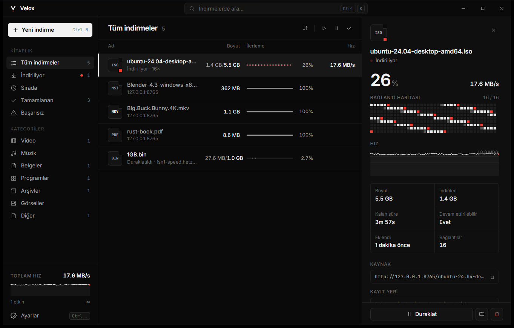

<p align="center">
  
</p>

<p align="center">
  <b>Blazing-fast, open-source download manager written in Rust.</b><br>
  Dynamic segmentation · browser integration · HLS/DASH capture · a quiet, minimal UI.
</p>

<p align="center">
  <a href="https://github.com/ethemdemirkaya/velox/releases/latest"></a>
  <a href="https://github.com/ethemdemirkaya/velox/actions/workflows/ci.yml"></a>
  
  
</p>

<p align="center"><a href="#türkçe">Türkçe</a> · <a href="#features">Features</a> · <a href="#install">Install</a> · <a href="#how-it-works">How it works</a> · <a href="#development">Development</a></p>

<p align="center">
  
</p>

## Features

| | |
|---|---|
| **Dynamic segmentation** | Up to 32 parallel HTTP/1.1 connections. When a connection finishes its range it steals half of the largest remaining one, so every connection stays busy until the very last byte. |
| **Adaptive & polite** | Connections ramp up gradually; if a server caps connections per client, extra workers step aside and the limit settles at what the server tolerates instead of failing. |
| **Crash-safe resume** | Progress is persisted to SQLite every 2 s. Pause, quit, reboot — downloads continue where they left off (validated with `If-Range`). |
| **Browser extension** | Chrome / Edge / Brave (Manifest V3). Captures downloads automatically, forwards cookies & referrer, hold <kbd>Alt</kbd> to let the browser handle a click. |
| **Stream capture** | Detects HLS (`.m3u8`, incl. AES-128) and DASH (`.mpd`) streams while you watch; a floating *Download* pill appears on videos. HLS segments are fetched in parallel. |
| **Speed limiter** | Global and per-download token-bucket limits. |
| **Scheduler** | Start the queue at a given time, pause at another, shut down or sleep when done. |
| **Smart folders** | Video, Music, Documents, Programs, Archives, Images — sorted automatically. |
| **Live connection map** | See every connection's range and write head in real time, plus a speed graph. |
| **Keyboard-first** | <kbd>Ctrl</kbd>+<kbd>K</kbd> command palette, <kbd>Ctrl</kbd>+<kbd>N</kbd> new, <kbd>Ctrl</kbd>+<kbd>V</kbd> paste a link anywhere, <kbd>Space</kbd> pause/resume, <kbd>↑</kbd><kbd>↓</kbd> navigate. |
| **Lives in the tray** | Clipboard watcher, launch at startup, native notifications, auto-update. |
| **Bilingual** | English and Turkish. |

## Speed

Real-world, same machine and network, 1 GB file from a Hetzner mirror:

| Client | Connections | Average |
|---|---:|---:|
| `curl` | 1 | 26.3 MB/s |
| **Velox** | 16 | **47.8 MB/s** |

On servers that throttle per connection the gain is much larger — the test suite runs a server limited to
2 MB/s per connection: one connection takes **14.4 s**, Velox with 16 connections **0.94 s** (~15×).
Your numbers depend on your line and the server.

## Install

1. Download the installer for your OS from the [latest release](https://github.com/ethemdemirkaya/velox/releases/latest)
   (`.exe` for Windows, `.dmg` for macOS, `.AppImage`/`.deb` for Linux).
2. Open Velox once — it registers the browser bridge (`com.velox.host`) automatically.
3. Browser extension: download `velox-extension.zip` from the same release, unzip it, open
   `chrome://extensions`, enable **Developer mode**, click **Load unpacked** and pick the folder.

> DASH capture and converting HLS `.ts` to `.mp4` use [ffmpeg](https://ffmpeg.org) if it is on your `PATH`.
> Without it HLS is saved as `.ts`, which plays everywhere.

## How it works

```
 Browser ──(extension, MV3)──► velox-host ──(named pipe / unix socket)──► Velox app ──► velox-core
            native messaging      tiny bridge                            Tauri + Svelte    Rust engine
```

| Path | What |
|---|---|
| [`crates/velox-core`](crates/velox-core) | The engine: probing, segment planning, work-stealing workers, positional writes into a sparse `.velox` part file, rate limiting, HLS/DASH, SQLite store, queue & scheduler. No UI dependencies — embeddable. |
| [`crates/velox-host`](crates/velox-host) | Native-messaging host started by the browser. Relays JSON to the running app and launches it if needed. |
| [`apps/desktop`](apps/desktop) | Tauri 2 shell (tray, single instance, autostart, updater, clipboard watcher, IPC server) and the Svelte 5 UI. |
| [`extension`](extension) | Chromium extension: download capture, stream detection, context menus, popup. |

A few details that matter for speed:

* **HTTP/1.1 only** for segmented downloads — HTTP/2 would multiplex all "connections" onto one TCP socket.
* The probe request (`Range: bytes=0-`) learns size, resumability, ETag and file name in one round-trip.
* The part file is marked **sparse on NTFS**, so writing a far-away segment doesn't stall while Windows zero-fills gigabytes.
* Each connection buffers 1 MiB and writes with positional I/O (`seek_write` / `pwrite`) — no shared file cursor, no locks on the hot path.
* Bytes are *reserved* under a tiny mutex before they are buffered, so a split never downloads a byte twice.

## Development

Requirements: Rust (stable), Node 20+, and the [Tauri prerequisites](https://tauri.app/start/prerequisites/) for your OS.

```bash
cd apps/desktop
npm install
npm run tauri dev        # builds the sidecar, starts Vite and the app
```

```bash
cargo test -p velox-core                     # unit + end-to-end tests (local HTTP server)
cargo run --release -p velox-core --example bench -- <url> 16   # benchmark the engine
```

Load `extension/` unpacked in Chrome while the dev app runs; `scripts/simulate-extension.mjs` talks to
`velox-host` exactly like the browser does, handy for testing without one.

Releases: push a `v*` tag. GitHub Actions builds Windows, macOS (Intel + Apple Silicon) and Linux bundles,
signs updater artifacts and attaches the extension zip to a draft release.

## Türkçe

**Velox**, Rust ile yazılmış, açık kaynaklı ve çok hızlı bir indirme yöneticisidir.

* **Dinamik segmentasyon:** 32'ye kadar paralel bağlantı. Bir bağlantı işini bitirince en büyük kalan parçanın yarısını devralır, böylece son bayta kadar tüm bağlantılar çalışır.
* **Tarayıcı eklentisi:** Chrome / Edge / Brave. İndirmeleri otomatik yakalar; tarayıcının indirmesini istediğinizde <kbd>Alt</kbd> tuşuna basılı tutarak tıklayın.
* **Video yakalama:** HLS (`.m3u8`, AES-128 dahil) ve DASH akışlarını algılar, videoların üzerinde *İndir* düğmesi gösterir.
* **Devam ettirme:** İlerleme SQLite'a kaydedilir; kapatıp açsanız bile kaldığı yerden devam eder.
* **Hız sınırı, zamanlayıcı, otomatik kategori klasörleri, pano izleme, tepside çalışma, otomatik güncelleme.**
* <kbd>Ctrl</kbd>+<kbd>K</kbd> komut paleti, tamamen klavyeyle kullanılabilir arayüz. Türkçe ve İngilizce.

**Kurulum:** [Son sürümden](https://github.com/ethemdemirkaya/velox/releases/latest) yükleyiciyi indirin ve Velox'u bir kez açın.
Eklenti için `velox-extension.zip` dosyasını açın, `chrome://extensions` → *Geliştirici modu* → *Paketlenmemiş öğe yükle*.

## License

Dual-licensed under [MIT](LICENSE-MIT) or [Apache-2.0](LICENSE-APACHE), at your option.
